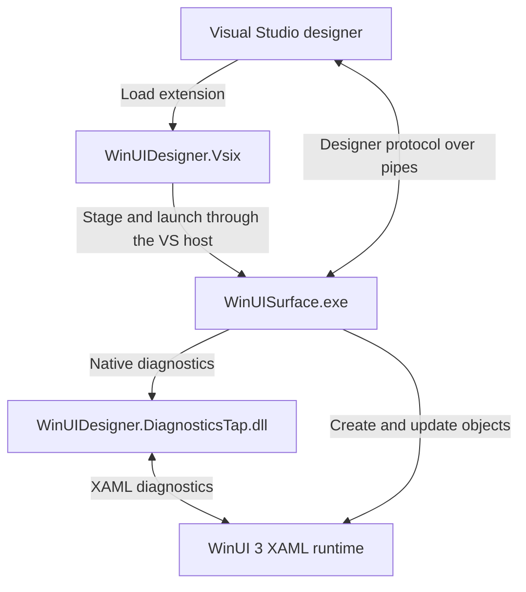

<h1 align="center">WinUI 3 Designer for Visual Studio</h1>

Design and preview WinUI 3 layouts in Visual Studio.

## Usage

Download and open a vsix file from Visual Studio Marketplace. WinUI 3 designer will be automatically available for WinUI 3 projects.

## Limitations

- Only C# WinUI projects are supported.
- x86 is not supported.
- `Window` and its subclasses cannot be previewed; only `FrameworkElement` subclasses are supported.
- Windows App SDK 2.5.1 is required.
- A `ContentDialog` as the root of a document is shown in a popup over the designer area, the way the framework shows a dialog. The popup covers the artboard (the size of the device) as a dialog covers the window of an app, with the card in the middle of it, and it is given the pan and zoom of the artboard, so it moves and scales with the document and what lies outside of the designer area is reached by scrolling. The card of the dialog has the size that the document asks for with `d:DesignWidth` and `d:DesignHeight`, each of them on its own and whatever the size of the designer area, and the size that its content asks for in a direction that the document says nothing about. The dialog has the theme of the preview, and so has the layer of smoke behind it.

## Structure

**`WinUIDesigner.Shared`**

A Visual Studio shared source project. It contains the common designer protocol message IDs, the app-resources request contract, and `WinUIDesignerLogger`.

**`WinUIDesigner.DiagnosticsTap`**

A native DLL loaded by the isolated WinUI surface process. It attaches to WinUI XAML Diagnostics, exposes property-value-source queries and rendering control to the managed surface, and implements the diagnostics TAP COM entry points.

**`WinUIDesigner.Surface`**

The self-contained WinUI 3 designer surface (`WinUISurface.exe`). It connects to Visual Studio through the designer's TAP/pipe contracts, builds and updates the XAML document, and handles designer operations such as selection, hit testing, property values, and layout. It calls `WinUIDesigner.DiagnosticsTap.dll` for native XAML diagnostics that are not exposed by the public WinUI API.

**`WinUIDesigner.Vsix`**

The in-process Visual Studio extension. It registers the WinUI XAML runtime, selects the WinUI platform implementation, reuses Visual Studio's designer host and process-isolation services, stages and launches `WinUISurface.exe`, and provides Toolbox integration.

## Architecture

See [Architecture](docs/architecture.md) for the designer's processing flow and implementation details.

## Diagnostics

Log files are written to `%LOCALAPPDATA%\WinUIDesigner\Logs`. Check `Options` > `WinUI Designer` in Visual Studio.
