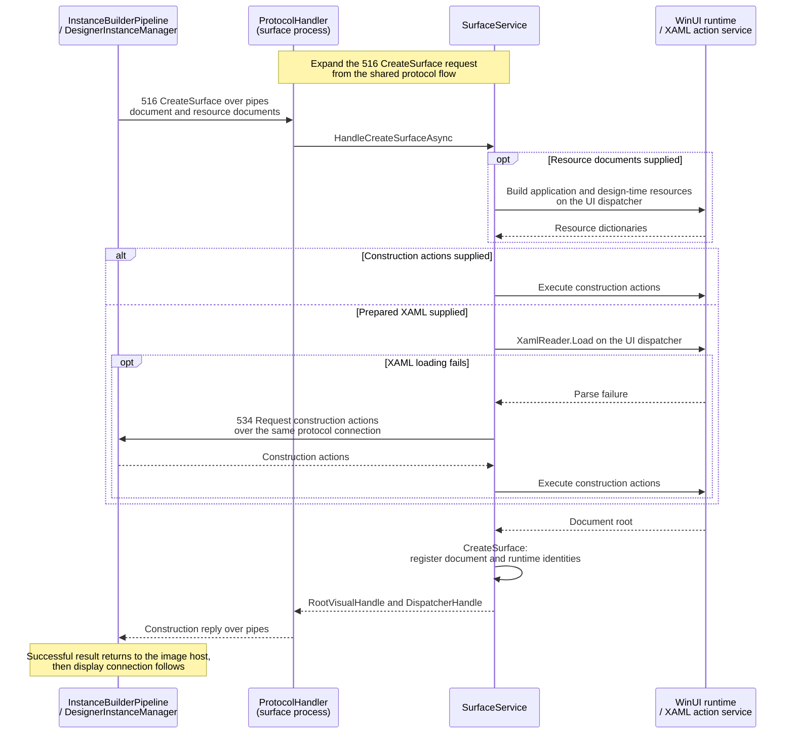
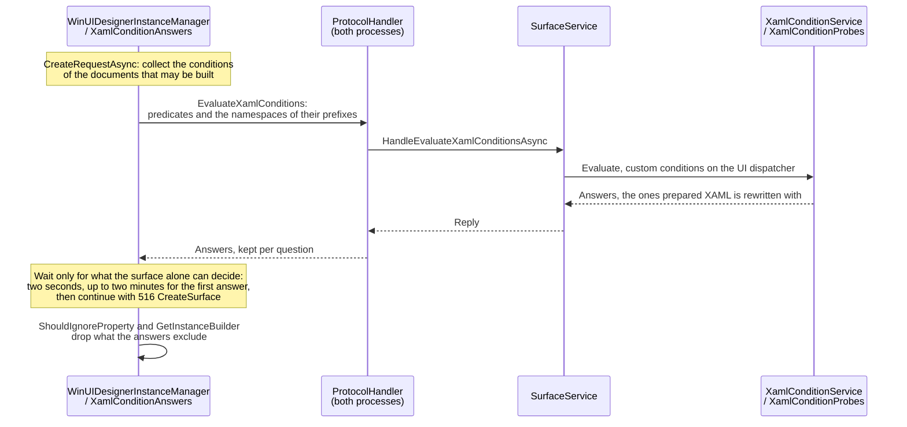
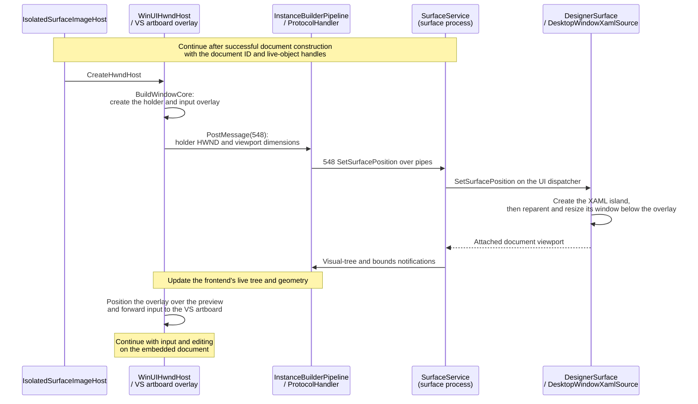
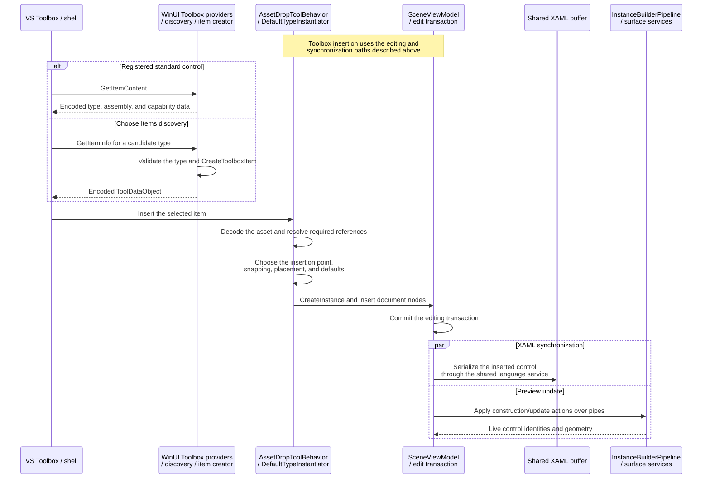
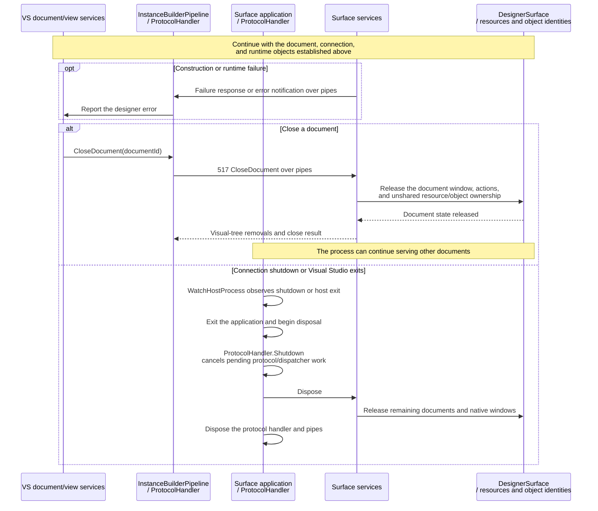

# WinUI designer implementation

This page describes the WinUI extension's implementation bindings, runtime, display adapters, and Toolbox providers. See [Architecture](architecture.md) for the shared designer flow and [UWP XAML Designer](uwp-designer.md) for the built-in UWP implementation.

- [Platform registration](#platform-registration)
- [Starting the isolated process](#starting-the-isolated-process)
- [Communicating with the surface](#communicating-with-the-surface)
- [Loading the XAML document](#loading-the-xaml-document)
- [Embedding the surface](#embedding-the-surface)
- [Handling designer operations](#handling-designer-operations)
- [Synchronizing XAML and design changes](#synchronizing-xaml-and-design-changes)
- [Toolbox integration](#toolbox-integration)
- [Error handling and lifetime management](#error-handling-and-lifetime-management)

> [!NOTE]
> Unless otherwise noted, shortened assembly names such as `DesignerHost.dll` refer to the full file name `Microsoft.VisualStudio.DesignTools.DesignerHost.dll`.

## Platform registration

The extension supplies the implementation bindings omitted by the built-in WinUI configuration. The following configuration examples show the WPF host binding and the desktop WinUI baseline.

For example, the configurations of .NET Framework WPF and WinUI for desktop .NET are registered as follows:

```csharp
RegisterPlatformConfiguration(WpfSpecification, new Dictionary<string, string>
{
    { "PlatformCreatorAssembly", "Microsoft.VisualStudio.DesignTools.WpfSurfaceDesigner" },
    { "PlatformCreatorType", "Microsoft.VisualStudio.DesignTools.WpfSurfaceDesigner.WpfFrameworkPlatformCreator" },
    { "HostPlatformAssembly", "Microsoft.VisualStudio.DesignTools.XamlDesignerHost.dll" },
    { "HostPlatformType", "Microsoft.VisualStudio.DesignTools.WpfDesignerHost.WpfHostPlatform" },
    { "ReferenceAssemblyMode", "TargetFramework" },
    { "PlatformSurfaceIsolatedGuid", "{ABC03A4E-B0A1-41B7-97BA-BB178F354CCD}" },
    { "SupportsToolboxAutoPopulation", "true" },
    { "ToolboxPage", "{7C9BECBA-12B9-4480-9DBF-2345AA3C4F9A}" },
    { "DesignerTechnology", "Microsoft:System.Windows:WPF" },
    { "ClipboardFormat", "CF_WINFX_TOOL" },
    { "ProjectFlavor", "{60dc8134-eba5-43b8-bcc9-bb4bc16c2548}" }
});
```

```c#
RegisterPlatformConfiguration(winuiSpecification, new Dictionary<string, string>
{
    { "DefaultTargetFramework", ".NETCoreApp, Version=5.0" },
    { "SupportsToolboxAutoPopulation", "true" },
    { "SupportsExtensionSdks", "false" },
    { "ToolboxPage", "{8A63BDE2-AEB9-4AF9-A00D-DBC9BD7D509C}" },
    { "DesignerTechnology", "Microsoft:Microsoft.UI.Xaml" },
    { "ClipboardFormat", "CF_WINDOWSUIXAML_TOOL" },
    { "AppPackageType", "WindowsXaml" }
});
```

The built-in WinUI configurations omit both assembly/type pairs. They contain other properties used by designer tools, but do not supply an editing platform or process host. The runtime mapping can still enable a design tab; this project's [platform registration](../src/WinUIDesigner.Vsix/WinUIDesignerPackage.cs) also supplies the missing implementation bindings.

The extension updates the existing desktop WinUI configuration and installs a creator hook that returns its WinUI creator, cached per editing service. This also covers services whose configuration snapshot predates the update. Calls for other XAML runtimes continue through Visual Studio's original implementation. Both the configuration changes and hook follow the extension package's lifetime.

## Starting the isolated process

For this extension, the project architecture selects `WinUISurface.x64.exe` or `WinUISurface.arm64.exe`; the selected executable is staged as `WinUISurface.exe`. Project media and library PRI files are also staged for resource lookup. Startup passes the Visual Studio process ID, diagnostics TAP path, pipe initialization data, DPI context, and Visual Studio installation root. The surface uses that root to resolve private designer contracts from the Visual Studio installation that launched it, initializes the WinUI application and dispatcher, registers its services, and starts receiving messages.

Implementation: [scene-view activation](../src/WinUIDesigner.Vsix/Platform/WinUISceneView.cs), [project context](../src/WinUIDesigner.Vsix/Platform/WinUIProjectContext.cs), [process host and staging](../src/WinUIDesigner.Vsix/DesignerHost), [local process context](../src/WinUIDesigner.Vsix/Platform/WinUISurfaceProcessContext.cs), and [surface startup](../src/WinUIDesigner.Surface/Program.cs).

## Communicating with the surface

The surface uses the existing private protocol types and adds a pipe bridge compatible with the host's initialization data. Its frame reader assembles complete messages even when reads return partial data. WinUI operations are marshalled to the UI dispatcher; the receive thread does not directly mutate XAML objects. Service observers are registered before protocol startup so an early request can be handled.

Implementation: [pipe bridge](../src/WinUIDesigner.Surface/Transport/SurfacePipeDataBridge.cs), [frame reader](../src/WinUIDesigner.Surface/Transport/MessageFrameReader.cs), and [service initialization](../src/WinUIDesigner.Surface/App.xaml.cs).

## Loading the XAML document

The surface first prepares application and design-time resources, then constructs the edited document on its UI thread. When XAML loading fails and actions were not supplied, it asks Visual Studio for construction actions. This alternative also lets the designer build objects individually and associate failures with the editing model.



In this extension, the markup provider prepares App.xaml and design-time resources without using the application's compiled App XBF, following the UWP and WPF providers' preparation flow. The instance manager follows UWP's App.xaml request policy: it sends the document while it is prepared, includes construction actions after an instance-building failure, and uses the UWP provider's eviction signal to choose the normal loading path. Prepared design-time resources follow WPF's state check. The surface retains these shared resource dictionaries across target-document rebuilds; when App.xaml is omitted from a later request, its last theme and resource configuration remains active. When a prepared resource document is sent again, the surface replaces its cached dictionary so edits take effect while keeping application resources before design-time resources. It then loads prepared XAML with WinUI's XAML reader or executes construction actions through its action service. Staged project assemblies, XAML metadata providers, and PRI files supply custom types and resources.

Prepared XAML carries an element's size as the design-time attached properties of `XSurfUwp.DT` (`DT.RuntimeWidth`, `DT.DesignHeight`, and so on). The XAML reader resolves the members of a type from a `using:` namespace only through the application's generated XAML metadata, and that metadata lists a type only when compiled markup mentions it. The surface therefore compiles a [dictionary it never loads](../src/WinUIDesigner.Surface/DesignTimeProperties.xaml) that names each of those properties; without it, every document that sets a width or a height fails to load and is built from construction actions.

The surface records stable runtime identities and source information, and reports visual-tree changes to Visual Studio. The returned root handle identifies an object; it is separate from the window used to display it. A successful construction reply therefore completes document creation, while embedding happens in the next stage.

Implementation: [document preparation](../src/WinUIDesigner.Vsix/Platform/WinUIDesignerInstanceManager.cs), [construction and tree notifications](../src/WinUIDesigner.Surface/Services/SurfaceService.cs), and [project type/resource resolution](../src/WinUIDesigner.Surface/Runtime/ProjectRuntimeResolver.cs).

### Namespace policies

Some members of a document apply only under a condition: those under a conditional XAML namespace (`xmlns:c7="...?IsApiContractPresent(...)"`) and those under an Uno Platform prefix (`win:`, `android:`, `not_win:`). A namespace policy classifies the members written under one `xmlns` prefix. It can keep them as plain members of their bare namespace, drop them, or leave them as written. The platform policy decides first, then the conditional policy; the sections below describe each policy.

The decision is made per prefix, not per namespace: `win`, `not_android`, and the default namespace all name the presentation namespace. Neither LINQ to XML nor the designer's document model keeps the prefix a member was written with, so both sides read it back from the source text.

The policies apply on both loading paths, so a member is treated the same way on either.

| Path | Where the policies apply |
| --- | --- |
| Prepared XAML | The surface parses the prepared XAML once, rewrites that document, and passes the result to the XAML reader. Source mapping uses the same document: a dropped element cannot claim a source position, and line information still refers to the prepared file. |
| Construction actions | Actions carry CLR names only, so the surface cannot tell which prefix a member had. The instance manager asks, for each property it is about to build, whether the property was written under a dropped prefix. An element under a dropped prefix gets an instance builder that creates nothing in the preview; the root is exempt. Templates are covered the same way: Visual Studio sends a template as a generated shell that declares none of the document's prefixes, and builds its content with construction actions (read in the designer assemblies of Visual Studio 18.13; 17.14 was not inspected). An item of a collection keeps its index through a stand-in, see [Child indices](#child-indices). |

A document without a policy namespace is recognized early and is not processed further: the surface looks at its `xmlns` declarations, and the Visual Studio side scans the text once each time it changes. A policy that fails is logged and skipped; it does not fail document construction.

Implementation: [policies and namespace scanning](../src/WinUIDesigner.Shared/Markup), [XAML rewriting](../src/WinUIDesigner.Surface/Markup/XamlNamespaceRewriter.cs), [surface integration](../src/WinUIDesigner.Surface/Services/SurfaceService.NamespacePolicies.cs), and [document-model filtering](../src/WinUIDesigner.Vsix/Platform/XamlMemberDispositionService.cs).

#### What the WinUI XAML reader does on its own

`XamlReader.Load` already implements both features for XAML text. Measured with Windows App SDK 2.5.1 in a standalone application:

| Markup | Result |
| --- | --- |
| Attribute, element, setter, merged dictionary, or property element under `IsApiContractPresent` / `IsApiContractNotPresent` | Applied when the condition holds, skipped otherwise. |
| The same property set under two complementary conditions | The branch whose condition holds is applied, in either attribute order. |
| `IsTypePresent`, `IsPropertyPresent` | Evaluated against Windows Runtime metadata. `Microsoft.UI.Xaml` types and the properties they declare count as present; see [Conditional namespaces](#conditional-namespaces) for the exact rules and for the surface process, where they do not. |
| A condition on a `using:` namespace | Evaluated. |
| A custom `IXamlCondition` | `Evaluate` is called once per argument. |
| A custom condition whose type cannot be resolved | The process ends with an access violation; no exception is raised. |
| The same `x:Key` in two complementary branches | One entry; no error. It is the branch that holds, except in a dictionary that also contains a style: there it is the entry written last. |
| An element or attribute under a prefix listed in `mc:Ignorable`, including a `#using:` URI and an element inside a typed collection | Skipped. |
| An element or attribute in an unknown namespace that is not ignorable | `XamlParseException`. |
| A `win:` attribute on an element from a `using:` namespace | `XamlParseException`: the property is not found. |
| An event handler attribute, prefixed or not | Accepted and ignored. |
| `x:Class` on the root | `XamlParseException`. |

Prepared XAML that reaches the reader unchanged is therefore loaded correctly in an application. The policies cover what the reader cannot: the construction-action path, source mapping of skipped elements, the conditions that end the process or are answered differently in the surface process, and previewing the markup for another Windows version or platform.

#### Conditional namespaces

A conditional namespace carries a predicate after a `?`. The members written under its prefix exist only when the predicate holds:

```xml
<Page xmlns="http://schemas.microsoft.com/winfx/2006/xaml/presentation"
      xmlns:cond="using:MyApp"
      xmlns:c8="http://schemas.microsoft.com/winfx/2006/xaml/presentation?IsApiContractPresent(Windows.Foundation.UniversalApiContract,8)"
      xmlns:c8n="http://schemas.microsoft.com/winfx/2006/xaml/presentation?IsApiContractNotPresent(Windows.Foundation.UniversalApiContract,8)"
      xmlns:newExp="http://schemas.microsoft.com/winfx/2006/xaml/presentation?cond:FeatureFlagCondition(NewExperience)">
    <StackPanel>
        <Border c8:CornerRadius="8" c8n:CornerRadius="0" />
        <newExp:InfoBar Title="New experience" IsOpen="True" />
    </StackPanel>
</Page>
```

The designer evaluates every predicate itself. The policy turns the answer into a verdict: the members are kept when the predicate holds and dropped when it does not. In the surface, the rewritten document contains no conditional namespace any more: a kept element moves to the bare namespace, a kept attribute loses its prefix, a dropped member is removed, and every decided declaration is bound to the bare namespace, because the prefix may still occur in an attribute value such as `TargetType="c8:Button"`. The root element is never removed.

The reader evaluates predicates as well, so the rewrite needs a reason. There are four:

- **The reader ends the process on predicates it cannot handle.** That happens without an exception, so nothing can be caught; the table below lists the cases. A typing error in a predicate, or a custom condition of a project that has not been built, would close the surface.
- **The reader answers differently in the surface process.** It answers `IsTypePresent` and `IsPropertyPresent` from `.winmd` files beside the executable. The surface is a single-file executable without them, so the reader there considers no `Microsoft.UI.Xaml` type present.
- **Source mapping** must not offer an element of the branch that does not apply as the source of a live element.
- **The construction-action path** has no reader at all; both paths have to give the same members.

##### Evaluating a predicate

A predicate is written `Name(arguments)` or `prefix:Name(argument)`, with nothing before the name and nothing after the closing parenthesis. The answers are kept per question, not per predicate: `IsApiContractPresent(X,7)` and `IsApiContractNotPresent(X,7)` ask one question, which is asked once. The two branches of an if/else pair therefore never both apply, in whichever order they are written. Answers are kept for the lifetime of the surface process, as the reader keeps them for the lifetime of an application.

| Predicate | Answered by |
| --- | --- |
| `IsApiContractPresent(contract, major)`, `IsApiContractPresent(contract, major, minor)`, and the `...NotPresent` forms | `ApiInformation.IsApiContractPresent` of the machine the designer runs on. |
| `IsTypePresent`, `IsPropertyPresent` and the `...NotPresent` forms, with a `Windows.*` type | `ApiInformation.IsTypePresent` and `IsPropertyPresent`: the metadata of the operating system. |
| The same with any other type | The metadata where it can be read, otherwise the projection assemblies. A type is present when it is a Windows Runtime type, which includes the ten types of `Microsoft.UI.Xaml` that C#/WinRT maps to .NET types (`ICommand`, `INotifyPropertyChanged` and the like) and the nine `*Helper` classes that it leaves out. A property is present on the type that declares it and not on derived types, whether it is public or protected (`Control.DefaultStyleKey`); events and the members of structures are not properties. The members that the projection adds to a collection (`Count`, `IsReadOnly`, the indexer) are not properties, and the count is `Size`, as it is in the metadata. A class that is only managed code, such as a control of the previewed project, is not present. |
| `prefix:Type(argument)`, or `Type(argument)` with a name that is not one of the six methods | The type is looked up in the `using:` namespace of the prefix, or of the default namespace, and has to implement `IXamlCondition`. One object is created per question, on the UI thread, and `Evaluate` receives the text between the parentheses exactly as written. |

The rules for types that are not part of the operating system reproduce the reader's answers in an application. The two basic rules (a type is present when it is a Windows Runtime type, a property is present on the type that declares it) were compared with the reader, case by case. The rules that close the gaps of the projection (the mapped types and the `*Helper` classes, protected properties, the members of collections) follow the metadata that the reader reads, `Microsoft.UI.Xaml.winmd` of Windows App SDK 2.5.1. They were derived from that metadata and the projection assembly, and were not run against the reader in an application.

A predicate that cannot be evaluated counts as not satisfied, and the surface logs a warning that names it: malformed text, an unknown method, an undeclared prefix, a condition type that is missing or is no `IXamlCondition`, and a condition whose constructor or `Evaluate` throws.

##### Where the designer differs from the reader

Measured with Windows App SDK 2.5.1. In each case the designer shows what the markup most plausibly means instead of failing.

| Markup | XAML reader | Designer |
| --- | --- | --- |
| An unknown method, a custom condition whose type cannot be found, white space before the name or before `(`, a version without digits | The process ends. With an undeclared prefix it ends even when no member uses the namespace. | The condition is not satisfied. |
| A missing parenthesis, text after `)`, a name with a dot, a wrong number of arguments, a type that is no condition, a condition that throws | An exception, some of them of a kind managed code only sees as `SEHException`. | The condition is not satisfied. |
| A version such as `7.0` or `7abc` | The leading digits are read: 7. | The condition is malformed and not satisfied. |
| The root element under a conditional prefix | The process ends: always when the condition does not hold, now and then when it does. | The root stays, as a plain element. |
| Two attributes for one property whose conditions both hold, or a plain attribute beside one whose condition holds | An exception: the property is set more than once. | The attribute written last applies; the rewrite of prepared XAML logs a warning. |
| Two elements under complementary conditions as the single content of an element | An exception: the property is set more than once. | The element whose condition holds. |
| A directive under a conditional prefix, such as `x7:Name` | An exception. | The directive applies when the condition holds. |
| A prefix that is declared again on a nested element | The outer declaration stays in effect, with its namespace and its condition. Only the default namespace can be declared again. | The inner declaration applies, as in XML. |
| The same `x:Key` under complementary conditions in a dictionary that contains a style | The entry written last, whichever branch it is. | The entry whose condition holds. |

##### Construction actions

Visual Studio builds a document from its own model when the surface asks for construction actions and for every edit. The model does not evaluate predicates, and only the surface can evaluate all of them, so Visual Studio asks it. The request is a message of this extension; Visual Studio's protocol handler dispatches by number alone and accepts numbers it does not know.



Visual Studio waits only for the predicates that it cannot decide itself: a custom condition, and a type or property of the application. A malformed or empty predicate is settled by code that both processes share, and a contract or a `Windows.*` type or property asks the same Windows the surface runs on, so these are decided from the first document on, even while the surface is still starting. The surface is asked all the same, and its answer replaces the local one.

The first answer of a surface process that has just started took about six seconds in a running designer, and about a minute while the machine was busy scanning for malware. The wait for it is therefore capped at two minutes, and a trace says after twenty seconds that the surface is still starting. It is one stretch of time for every document that waits for it, so a second document that loads meanwhile waits for the same answer; it is used up only when it ran out or an answer arrived, and a surface that never answers costs it once.

Nothing waits for the surface while a document is being built, and answers take effect only before a document is sent. A document that is being built, on the protocol thread of Visual Studio or in an edit, is judged with one set of answers: its verdicts are kept until its text changes or it is loaded again, and a question has one answer in that time, whichever member asks, so the two branches of an if/else pair always agree. A verdict that changed halfway through would build an element as written and then drop its properties; the surface cannot create a `Setter` without its `Property`. An answer that arrives later takes effect with the next document that is loaded; a document whose text changes meanwhile is judged with the answers that already took effect. The questions that the documents of a request raise are sent together, in one request. The answers are used as follows:

| Situation | Result |
| --- | --- |
| A predicate that is malformed or empty, about a contract, or about a `Windows.*` type or property | Decided by Visual Studio from the first document on, by the shared code or on the same operating system as the surface, and confirmed by the surface in the background. |
| A custom condition, or a type or property of the application | The document waits for the answer when the predicate is new. Until the surface has answered any request, the members are built as written; after that, a custom condition that was not answered yet does not apply, and a type or property predicate is left as written, until the answer takes effect with the next document. A surface that does not know the message never answers. |
| The predicate was answered | The answer of the surface. |

Changing only the prefix of an element or of an attribute, or the condition of an `xmlns` declaration, changes which members apply without changing the document model: Visual Studio's incremental update compares types and values, finds the same ones, only replaces the source references of the nodes, and builds nothing. The preview would keep showing the old branch, and the edits that follow would be discarded or land on a neighbour. After each parse of an edit the extension therefore compares which elements and properties of the document are dropped with what they were when the document was loaded or last compared. For the element that holds a changed element, or has a changed property, it raises the change that Visual Studio itself uses to build a node again; that goes the way of every other change of the document and builds the node with the verdicts of now. What this says about Visual Studio (the incremental update, the event after a parse, the change that builds a node again) was read in the designer assemblies of Visual Studio 18.13; 17.14 was not inspected.

##### Limitations

- Visual Studio's document model keeps one value per property. Of `c8:CornerRadius="8" c8n:CornerRadius="0"` it keeps the second attribute, and of two property elements for one property, such as `<c8:Border.Background>` followed by `<c8n:Border.Background>`, the second one; an attribute is always read before a property element. When the one it kept is dropped, the earlier value is gone and the property stays unset on the construction-action path. The extension logs a warning for attributes and property elements. Prepared XAML is not affected. Writing the branch that applies last avoids the difference.
- A change of which members apply on the root element, or directly inside it, takes effect when the designer is reloaded: a change of the root is not a change that Visual Studio builds a node again for (read in the designer assemblies of Visual Studio 18.13; 17.14 was not inspected). A warning is logged.
- A dictionary that the XAML reader loads by itself, such as the compiled resources of a control library, is not rewritten. The reader evaluates its predicates, with its own answers in the surface process, and it still ends the process on a predicate it cannot handle, such as a custom condition whose type it does not find.
- A custom condition runs without the state of the application: the designer does not run the code that sets feature flags at startup.
- Visual Studio's XAML language service reports `XLS0310 '<prefix>:<Type>' is an invalid conditional method` for a custom condition. Its validation (`UwpNamespaceCondition.Validate` in `Microsoft.VisualStudio.DesignTools.XamlLanguageServiceBase.dll`) accepts only the six `ApiInformation` methods, and it has no extension point: the platform metadata returns an internal namespace generator. The error stays in the Error List; it does not affect the preview.
- A predicate is evaluated once per surface process. A condition class that changed, or whose answer would be different now, takes effect only in a new surface process.
- Contract predicates describe the machine the designer runs on. Previewing another Windows version is not implemented.

Implementation: [predicate grammar](../src/WinUIDesigner.Shared/Markup/XamlCondition.cs), [evaluation](../src/WinUIDesigner.Shared/Markup/XamlConditionService.cs), [probes of the surface](../src/WinUIDesigner.Surface/Runtime/XamlConditionProbes.cs), [surface integration and message handler](../src/WinUIDesigner.Surface/Services/SurfaceService.NamespacePolicies.Conditional.cs), [answers on the Visual Studio side](../src/WinUIDesigner.Vsix/Platform/XamlConditionAnswers.cs), [request before a document is sent](../src/WinUIDesigner.Vsix/Platform/WinUIDesignerInstanceManager.Conditional.cs), and [builder for dropped elements](../src/WinUIDesigner.Vsix/Platform/WinUIInstanceBuilderPlatform.Conditional.cs). The [sample page](../samples/WinUIDesignerSampleApp/ConditionalXamlPage.xaml) shows the constructs on elements, and the [sample dictionary](../samples/WinUIDesignerSampleApp/Themes/ConditionalResources.xaml) on resources.

#### Uno platform prefixes

[Uno Platform markup](https://platform.uno/docs/articles/platform-specific-xaml.html) assigns a member to a platform through the prefix it is written under. The designer previews the Windows build of such markup, which is what the Windows XAML compiler makes of it. The previewed platform is one value, the target `win`, set in the surface and in the instance manager. The classification is the same for every target, but previewing another platform also needs the prepared-XAML route described below, because the document model that construction actions are generated from has no nodes for the members of an ignorable Uno namespace.

| Prefix | Documented namespace | On Windows |
| --- | --- | --- |
| `win`, `winappsdk`, and `not_` followed by `android`, `ios`, `tvos`, `macos`, `wasm`, `desktop`, `skia`, `androidskia`, `iosskia`, or `wasmskia` | The presentation namespace | Kept. Elements stay; attributes become plain attributes of their element. |
| `not_win`, `not_winappsdk`, `xamarin`, `android`, `ios`, `tvos`, `macos`, `wasm`, `desktop`, `skia`, `androidskia`, `iosskia`, `wasmskia`, `netstdref`, `not_netstdref` | `http://uno.ui/<prefix>`, optionally followed by `#using:` and CLR namespaces, listed in `mc:Ignorable` | Dropped, elements together with their children. |
| Any other prefix bound to `http://uno.ui/...` and listed in `mc:Ignorable` | | Dropped. |
| Any prefix bound to a CLR namespace, such as `xmlns:skia="using:SkiaSharp.Views.Windows"` | | Not a platform prefix; left as written. |

The prefix decides, compared exactly as Uno compares it. The list is the union of the prefix tables of the Uno documentation across its versions, and each prefix names the targets whose builds include it; a negated prefix is included wherever its positive form is not. Windows is the exception, because the Windows build is made by the Windows XAML compiler, which knows no platform prefixes and includes what it can resolve: on Windows a platform prefix is kept exactly when it is bound to the presentation namespace, whatever its name says. So `not_netstdref`, documented with an Uno namespace, is dropped, and `not_win` or `android` bound to the presentation namespace is kept, as the Windows build keeps it. A platform prefix is applied whether or not it is listed in `mc:Ignorable`. A platform namespace that is missing from `mc:Ignorable` is logged as a warning with its position, because the Windows XAML compiler rejects it. Only a declaration that an element or an attribute is written under counts (a prefix that only occurs inside an attribute value does not): the compiler does not look at one that nothing uses, and a document may declare every platform prefix as boilerplate. The warning is made once for each text of the document, not once for each request.

The two loading paths reach this result differently. The table shows what Visual Studio 18.13 does with platform prefixes before the extension gets involved, measured on the prepared file of a running designer and by running the designer's cleaner and parser against WinUI metadata:

| Markup | XAML cleaner (prepared XAML) | Parser (document model) |
| --- | --- | --- |
| Attribute or property element under an ignorable Uno namespace | Passed through as written. | No node. |
| Object element under an ignorable Uno namespace, such as `<not_win:Border>` or `<skia:ColumnDefinition>` | Replaced by `FallbackControl` of `using:XSurfUwp.Fallback`. The children are removed, as are the attributes the stand-in does not support, and the prefix is lost. | No node, for the element or for its children. |
| The same, in the first document a cleaner context cleans | Passed through as written: the context has not created its stand-in types yet. | |
| Object element under an Uno namespace that is not ignorable | Replaced by `FallbackControl`. | Error; a node of an unknown type. |
| `win:` element or attribute | Passed through as written. | An ordinary node. |
| `win:` attribute on an element written under a `using:` prefix | Passed through as written. | Error; no node. The Windows XAML compiler rejects the attribute as well (WMC0011). |

On the prepared-XAML path the surface rewrite drops what is written under a dropped prefix and turns kept attributes into plain ones, which also makes a `win:` attribute on a `using:` element loadable. On the construction-action path nothing has to be dropped for Windows: the members of an ignorable Uno namespace never become nodes, and a member under a platform prefix that is bound to the presentation namespace is an ordinary node that is kept, as it is on the prepared-XAML path.

An object element under an Uno namespace is the exception, because its stand-in can no longer be told from the stand-in of an unknown control. Inside a typed collection the stand-in cannot be loaded; elsewhere it becomes a placeholder whose source position resolves to the preceding element of the document. The instance manager therefore builds a document that contains such an element from construction actions; this applies to the edited document, App.xaml, and the design-time resources, which are the documents a request carries. App.xaml and the design-time resources are looked at only while the request is going to send them: a document that another request is still loading may be read by the surface at that moment. Other documents that Visual Studio prepares, such as resource dictionaries merged through `Source`, are not sent and are not looked at.

The alternative keeps the prepared XAML: the document is cleaned a second time while the instance-builder platform answers that there is no fallback type for an unresolved element, so the element passes through as text, with its children, and the surface rewrite decides about it. The result replaces the prepared file and the position mapping of the document, and is discarded in favor of construction actions when the elements are not in it or the file cannot be written. Only this route preserves the children that another target platform needs. Loading a document this way was confirmed in Visual Studio 18.13; it stays off until editing afterwards and Visual Studio 17.14 have been checked as well. Setting the environment variable `WINUIDESIGNER_REPREPARE_RAW_PLATFORM_ELEMENTS=1` before Visual Studio starts turns it on.

Limitations:

- Only the Windows target can be previewed. Another target would also need every document on the prepared-XAML route, which only the second cleaning provides and which is off by default.
- Uno treats the namespace of an excluded prefix as arbitrary. An object element under such a prefix is only recognized when the namespace is an Uno one; with another namespace, such as `http://nventive.com/android`, its stand-in stays. Attributes and property elements are handled with any namespace.
- A platform prefix that is missing from `mc:Ignorable` is dropped from prepared XAML, but its object elements are nodes of an unknown type in the document model and appear as such when the document is built from construction actions.

Implementation: [prefix table and classification](../src/WinUIDesigner.Shared/Markup/UnoPlatformPrefixes.cs), [surface target](../src/WinUIDesigner.Surface/Services/SurfaceService.NamespacePolicies.PlatformPrefixes.cs), [document preparation](../src/WinUIDesigner.Vsix/Platform/WinUIDesignerInstanceManager.PlatformPrefixes.cs), [second cleaning](../src/WinUIDesigner.Vsix/Platform/WinUISurfaceProcessMarkupProvider.PlatformPrefixes.cs), [fallback suppression](../src/WinUIDesigner.Vsix/Platform/WinUIInstanceBuilderPlatform.PlatformPrefixes.cs), and the [sample page](../samples/WinUIDesignerSampleApp/PlatformPrefixesPage.xaml).

#### Child indices

Visual Studio addresses the children of a collection by their index in its document model: construction actions and every later edit add, remove and look up a child at the index of its node. The document model keeps the elements a policy drops, such as the branch of a conditional namespace that does not apply; the live collection has no object for them. In the `StackPanel` of the [sample page](../samples/WinUIDesignerSampleApp/ConditionalXamlPage.xaml), the element after "Contract 99 is not present." is child 5 of the document model and child 3 of the live collection.

Each live collection that lost elements therefore keeps the model positions of its dropped elements, its holes, and every child action on the collection goes through them:

| Action | Effect |
| --- | --- |
| `AddChild` of the stand-in of a dropped element | Records a hole at the index. The live collection does not change. |
| `AddChild` | Inserts at the index minus the holes before it. The holes at and after the index move up by one. |
| `RemoveChild` | At a hole, removes the hole and nothing else. Otherwise removes the object at the index minus the holes before it. The holes after the index move down by one. |
| `GetChild` | At a hole, a stand-in, which ends the path (see below). Otherwise the object at the index minus the holes before it. |
| `ClearCollectionProperty` | Forgets the holes of the collection. Visual Studio adds every child again afterwards, stand-ins included. |

Visual Studio builds almost nothing beneath a dropped element, and the surface ends the path at the stand-in. The one exception is the entries of a dropped merged dictionary: the dictionary-entry builder of Visual Studio reaches an entry through the proxy of its dictionary, which stays valid, so editing a resource inside the dropped dictionary, or renaming its key, still sends `GetDictionaryEntry`, `UpdateDictionaryValue`, `AddDictionaryEntry` and `RemoveDictionaryEntry` for the stand-in, and `SetProperty` for the entry (read in the designer assemblies of Visual Studio 18.13; not run live, and 17.14 was not inspected). There is no object behind the stand-in. A lookup in it (`GetProperty`, `GetChild`, `GetDictionaryEntry`) gives the stand-in again, so that the actions that follow end there as well, and every change of it (`SetProperty`, `ClearProperty`, `ClearCollectionProperty`, `AddChild`, `RemoveChild` and the three changes of a dictionary entry) changes nothing. An edit inside a dropped dictionary therefore has no effect on the preview, and it does not fail the batch.

Visual Studio sends the child actions of a collection in an order that is consistent when they are applied one after the other; the stock surface depends on that as well. Applying them to the holes in the same order keeps both views in step through insertions, removals, moves, replacements, undo and redo, including edits that add or remove dropped elements themselves. With or without holes, a removal at an index past the end changes nothing and is logged as a warning instead of failing the batch, a lookup there finds nothing, and an insertion past the end appends, as it did before. A collection without holes uses the indices exactly as Visual Studio sends them.

Setters are the one kind of child that is not added when its action arrives: WinUI accepts only complete setters, so the surface adds them when their batch ends. Their positions are decided when the action arrives, counting the setters of that collection that are still waiting. A removal, a lookup or a clear in the same collection first adds the waiting setters, so that every index applies to the collection as Visual Studio sees it: a batch that adds a setter and then removes another one of the same style removes the one it means.

The holes come from both ways a document is built:

- **Construction actions.** The instance builder of a dropped item of an indexed collection, such as a child of a panel, an item, a column definition, a setter or a merged dictionary, creates a stand-in of type `XSurfUwp.DroppedElement` instead of nothing. Only the surface knows the type; Visual Studio passes the name on, as it does for its own fallback controls. The parent's builder then adds the stand-in with the index of its node, during the first build and for every edit (`CoreInstanceBuilder.UpdateChild` and `ModifyChild` in `RuntimeHostBase.dll`), and removes and looks it up like any other child. The surface records the hole instead of adding anything. A dropped property value or dictionary entry still creates nothing: its parent addresses it by property or by key.
- **Prepared XAML.** The rewrite reports every element it removes from a collection: the element that holds the collection, the property element the item was written in or the content, and the position of the item among the items of that collection as the document model counts them. Before the XAML reader loads the document, the surface marks each such element with the attached property `DT.DroppedChildOwner`. The reader sets the mark on the object it creates, so the surface hears of the object of every marked element, also of a style or a resource dictionary, which no source mapping reaches. The mark can only be set on a `DependencyObject`, and WinUI's collections are none: an explicit collection element such as `<TransitionCollection>` is marked through the property element it is written in (`Grid.ChildrenTransitions`, `Setter.Value`), on the element that holds the property. Once the document is loaded, the surface finds the collection, the content property from the `ContentPropertyAttribute` of the type or the property of the property element, gives it its holes and clears the marks.

The position of a removed element counts the items that precede it in its collection, as far as the document model has a node for them:

| Preceding element | Counted |
| --- | --- |
| An object element that is kept or left as written | Yes |
| An element of a conditional namespace whose condition does not hold | Yes, as a hole |
| An object element under an Uno platform prefix that is not listed in `mc:Ignorable` | Yes, as a hole: the document model has a node of an unknown type for it |
| An element under a prefix listed in `mc:Ignorable` that no policy keeps, such as `not_win:` or `skia:` | No: the document model has no node for it, and the XAML reader skips it |
| A property element | No |

An element such as `<skia:ColumnDefinition>` in the [sample page](../samples/WinUIDesignerSampleApp/PlatformPrefixesPage.xaml) therefore needs no hole: neither the document model nor the live collection has it, so their indices agree. Measured with Windows App SDK 2.5.1, the marks, the content properties and the projected collections (`UIElementCollection`, `ColumnDefinitionCollection`, `SetterBaseCollection`, `ItemCollection`, `MergedDictionaries`) behave as described; the runtime hands out the same collection object as long as the surface holds it, which its maps do.

Limitations:

- A collection whose element has text content other than white space, such as the inlines of a `TextBlock` that contains words, receives no holes from prepared XAML: text becomes items there and the positions cannot be told reliably. White space between the elements is not text, because every indented document has it between the children of a panel; the elements of such a collection are counted as they are. Whether Visual Studio's document model counts the white space between inline elements as items was not checked. Visual Studio rebuilds an inline collection on every edit, and that rebuild carries the stand-ins.
- A collection of an element the XAML reader does not create while it loads the document, such as template content, receives no holes from prepared XAML. Neither does the collection of an element that is not a `DependencyObject` and is not the value of a property of one, such as a plain CLR class of the project that holds a collection: the reader can set the mark only on a `DependencyObject`, and the surface does not mark an element whose type it knows to be none. The other collections of the document are not affected. An element whose type the surface cannot find is marked. When the reader fails a document that has marks, the surface cannot tell why, so it loads the document again without them. If that works, the marks were the reason: the surface logs a warning, and none of the collections of the document receive holes from prepared XAML. If it fails as well, the marks were not the reason: nothing is logged about them, and the document is built from construction actions as it was before.

Implementation: [hole bookkeeping](../src/WinUIDesigner.Surface/Common/ChildIndexMap.cs), [maps per collection](../src/WinUIDesigner.Surface/Common/ChildIndexMaps.cs), [translation of the child actions](../src/WinUIDesigner.Surface/Common/ChildIndexTranslator.cs), [dictionary actions on a stand-in](../src/WinUIDesigner.Surface/Common/DictionaryEntryActions.cs), [action handling](../src/WinUIDesigner.Surface/Services/SurfaceService.XamlActions.cs), [WinUI collections and loaded documents](../src/WinUIDesigner.Surface/Services/DroppedChildren.cs), [positions of the rewrite](../src/WinUIDesigner.Surface/Markup/XamlNamespaceRewriter.cs), [owner marks](../src/WinUIDesigner.Surface/Markup/DroppedChildOwnerMarks.cs), [stand-in name](../src/WinUIDesigner.Shared/Markup/DroppedElementStandIn.cs), and [builder of the stand-in](../src/WinUIDesigner.Vsix/Platform/WinUIInstanceBuilderPlatform.Conditional.cs).

## Embedding the surface

The extension hosts the document in `DesktopWindowXamlSource` and attaches its window beneath the designer overlay. This diagram expands the WinUI display adapter after document construction.



The WinUI scene adapter replaces UWP's image host while retaining the shared artboard and tools. It sends the holder window and viewport dimensions after the document exists. The surface creates its XAML island, reparents the window, and keeps it below the overlay. The adapter forwards overlay input to the designer's tools.

Viewport size, preview device size, and pan/zoom are separate values. The viewport clips the visible area, device size controls the document's layout, and pan/zoom transforms its content. Keeping these separate allows the overlay, runtime bounds, and hit-test coordinates to agree as the user scrolls or zooms. Layout, bounds, and DPI notifications update the frontend's live view of the surface.

Implementation: [scene and window adapter](../src/WinUIDesigner.Vsix/Platform/WinUISceneView.cs), [overlay placement](../src/WinUIDesigner.Vsix/Platform/WinUIOverlayWindow.cs), and [WinUI island](../src/WinUIDesigner.Surface/Designer/Surface/DesignerSurface.cs).

## Handling designer operations

The surface implements these operation groups:

| Operation | Runtime work |
| --- | --- |
| Property queries | Return live values, base/current values, value sources, and layout information. |
| Hit testing | Find live elements at a point or within a rectangle and return their identities. |
| Snapping | Return container-relative edges, centers, and supported text baselines. |
| Model changes | Create objects, set or clear properties, edit collections and dictionaries, and update names and resource relationships. |
| State and animation preview | Apply visual states and control storyboards on the UI thread. |

The protocol handlers belong to one `SurfaceService`, split into partial files for hit testing, snapping, XAML actions, properties, and animation. The shared constructor initializes their state and registers observers; `Dispose` unregisters the observers and releases the document state.

Property origins matter to the editing model: a default, local value, or style value can require a different edit. The native diagnostics helper supplies value-source information unavailable through the public WinUI property API. When diagnostics are unavailable, the property handlers fall back to inspecting local values and explicit style setters. Preview-only dimensions are kept separately from authored dimensions so the preview does not write its device size into XAML.

During a drag, the shared designer updates temporary edits and commits or cancels the final transaction. Its pipeline invalidates cached live values after processing changes and uses runtime geometry to refresh adorners. Rendering can also be suspended while related changes are applied; that suspension is separate from the editing transaction and cache invalidation.

Implementation: [designer operations](../src/WinUIDesigner.Surface/Services), [object identities](../src/WinUIDesigner.Surface/Designer/Shared/ObjectIdentityRegistry.cs), and [native diagnostics](../src/WinUIDesigner.DiagnosticsTap/DiagnosticsTap.cpp). The XAML action handlers report unsupported actions as errors; this implementation does not imply complete parity with every built-in designer operation.

## Synchronizing XAML and design changes

This extension reuses that frontend synchronization. Its responsibility is to preserve the document/object correspondence while applying action batches in order, then report the surviving visual tree and layout. Removing a visual does not immediately invalidate every object handle: an undo operation may reconnect an existing object before the document is closed.

Implementation: [ordered action execution](../src/WinUIDesigner.Surface/Services/SurfaceService.XamlActions.cs), [document ownership](../src/WinUIDesigner.Surface/Designer/Shared/ObjectIdentityRegistry.cs), and [tree/layout publication](../src/WinUIDesigner.Surface/Services/SurfaceService.cs). Text parsing and serialization themselves are provided by Visual Studio's `Markup.dll` and XAML language service.

### Edits of styles in use

WinUI seals a `Style`, its `Setters` and each `Setter` as soon as an element uses the style, even a style that Visual Studio has just created: its instance builders assign a new style before they add its setters. The public API then rejects added setters and setter or `BasedOn` changes, and accepts removed setters without updating the elements. Visual Studio's UWP designer has the same constraint; its `StyleBuilder` and `SetterBuilder` still send `AddChild` and `RemoveChild` for the setter collection (a changed setter is replaced by a new one), and its TAP applies them through the framework's XAML Diagnostics, which unseals the objects, rebuilds the setters of styles `BasedOn` the edited one, re-applies implicit styles and refreshes the elements that use the style.

The surface sends the same edits through its diagnostics TAP: those of sealed collections, setters and styles, and those of `VisualState` setters while the state can be active (only this path updates the active state; the visual states of a document or a lookup value that is still being built take the public API). WinUI tracks the users of a style only while it stores source information, so the surface sets `ENABLE_XAML_DIAGNOSTICS_SOURCE_INFO` at startup. Without the TAP connection, an edit of a sealed object fails with a message that asks for a refresh, and an edit of visual state setters falls back to the public API, which changes the active state only when it is entered again; each is logged once.

Visual Studio rebuilds a style after a `TargetType` change, when its first setter is added or its last one removed, and when a setter is removed from an implicit style, and it replaces the dictionary entry by removing the key and adding the new style. The removal of a style goes through the TAP, and so does the one addition under the same key that pairs with it, in the same batch or a later one, so that the framework moves the `{StaticResource}` references it recorded to the new style. The references that the surface resolved for actions are unknown to the framework, so the surface moves them itself where WinUI accepts the new style: the `Style` of the elements in the open documents, and `BasedOn` of the styles that actions based on the old style and of the styles in the same dictionary and in the application resources. Without the TAP connection the dictionary edits fall back to the public API; the elements that use the style as an implicit style, and the other references to it, then keep the old style until the designer is refreshed.

Implementation: [style edits](../src/WinUIDesigner.Surface/Services/StyleEditService.cs) and [diagnostics TAP](../src/WinUIDesigner.DiagnosticsTap/DiagnosticsTap.cpp).

## Toolbox integration

Toolbox integration has three entry points. Static registration supplies standard controls, discovery supplies selectable types from assemblies, and automatic population watches project or package references. The configuration flag enabling automatic population does not itself discover controls.

| Entry point | This extension's implementation |
| --- | --- |
| Standard controls | Register the Common and All XAML control groups from the WinUI registration attribute's item list and provide encoded item content through the package's Toolbox provider. |
| Choose Items | Register WinUI discovery, item creation, and an isolated metadata AppDomain. Accept eligible public, non-abstract controls with a public parameterless constructor. |
| Automatic population | Reuse the available VS infrastructure; complete WinUI project/NuGet discovery is not supplied by the above registrations. |

The inspected VS automatic project source recognizes WPF and UWP base types, but does not list `Microsoft.UI.Xaml.FrameworkElement`. Consequently, the WinUI configuration's automatic-population flag cannot be taken as proof that every project control will appear. The extension supplies standard controls explicitly and a separate WinUI Choose Items discovery path.

The static item list follows the WPF/UWP grouping model: selected everyday controls appear in both the Common and All groups, while the All group contains every registered standard control. Each entry records its qualified type name and Windows platform metadata, and the same item data is used to register both groups.



A Toolbox item describes a type to create; it does not carry an already-created WinUI control into Visual Studio. The extension encodes the shared XAML Toolbox format and adds WinUI capability information. On insertion, the shared tools resolve required references, select a valid destination, and apply placement and default values through the document model. The ordinary text/runtime synchronization then handles the new control.

The preferred Choose Items page identifies the registered discovery provider. It is separate from the static Common and All groups. The metadata AppDomain used for discovery is also separate from the process that renders the document.

Implementation: [Toolbox providers and registration](../src/WinUIDesigner.Vsix/Toolbox) and [package registration](../src/WinUIDesigner.Vsix/WinUIDesignerPackage.cs).

## Error handling and lifetime management

Failures can occur before the surface starts, while the connection initializes, during document construction, or after the preview is displayed. A created tab, running executable, or successful construction reply proves only that particular stage completed.

| Stage | Failure handling in this extension |
| --- | --- |
| Platform and staging | Reject missing private contracts, unsupported project/runtime architectures, missing payloads, and detected WinUI runtime version mismatches. |
| Startup and communication | Log startup exceptions and child-process exits; bound frame sizes and fail incomplete messages. |
| Document construction | Attempt the action-based loading alternative, then return construction failure information and publish error notifications. |
| Runtime operations | Return contract-specific failure results or notifications; dispatcher work observes cancellation and timeouts. |
| Shutdown | Cancel pending protocol work, release document services and native windows, and dispose the connection. |



Closing a document releases its surface and document-owned state. Resources shared with another document are retained until their remaining owners are released. Document closure and process shutdown are separate lifetimes; the connection can serve more than one document.

The surface watches the Visual Studio process and exits when its host disappears or the protocol shuts down. On disposal, it shuts down protocol work before releasing its services and pipes. The extension package also restores the platform configuration entries and removes its creator hook when disposed.
